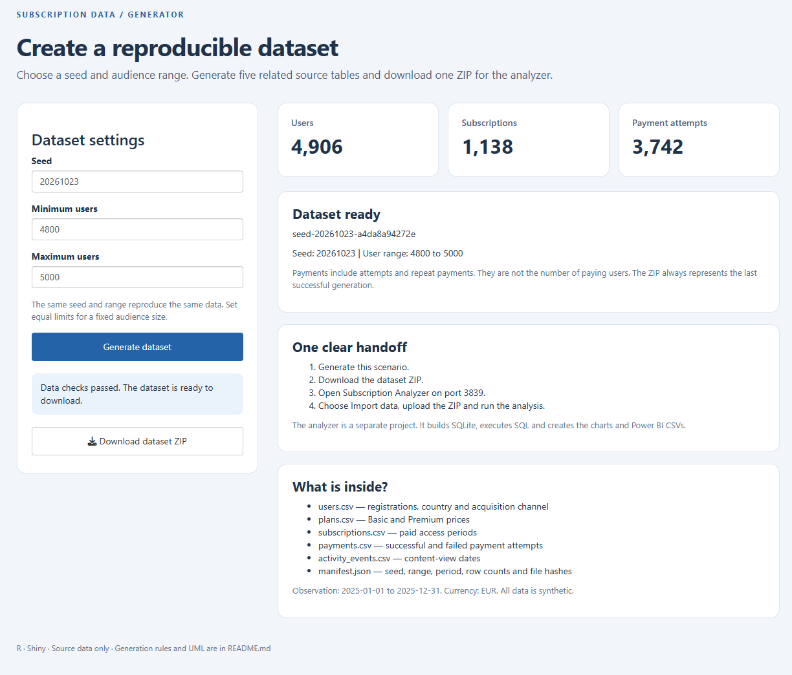
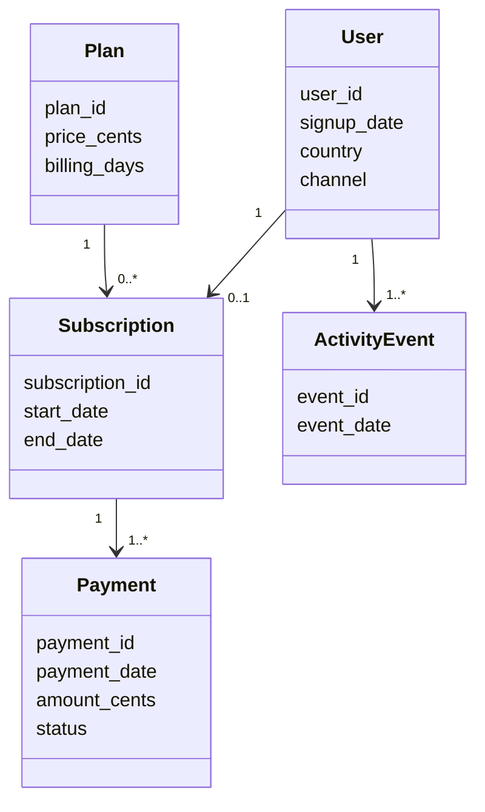

# Subscription Data Generator

A compact R/Shiny application that creates reproducible source data for a fictional digital content subscription service. The separate **Subscription Analyzer** imports its ZIP and performs the analysis.

**R · Shiny · Synthetic data · Reproducibility**

## Project preview



A successfully generated **v2 scenario with 4,906 users**, using seed `20261023` and the 4,800-5,000 audience range. The screen shows validation status and the downloadable ZIP handoff to the analyzer.

This generator example differs from the analyzer's preserved **4,890-user presentation case**, which was created with generator v1. The same seed does not imply identical output across generator versions.

## Run

With Docker Desktop running, open a terminal in this folder:

```sh
docker compose up --build
```

Open **http://localhost:3838**. Later starts use `docker compose up`; stop with Ctrl+C.

Without Docker, install R 4.3 or later, then run from this folder:

```sh
Rscript setup.R
Rscript start.R
```

In RStudio, open `SubscriptionGenerator.Rproj`, run `source("setup.R")` once, then `source("start.R")`.

## Generate → download → analyze

1. Choose a whole-number seed and a user range (default 4,800–5,000; supported limits 100–20,000).
2. Click **Generate dataset**. Review the actual counts and validation status.
3. Click **Download dataset ZIP**.
4. In Subscription Analyzer, open **Import data**, select this ZIP and click **Run analysis**.

The same seed **and the same range**, under this generator version, reproduce the same data. Equal minimum and maximum values produce a fixed audience size. Editing controls does not change an already generated download; generate again to apply them.

## Output contract v2.0

```text
dataset.zip
  manifest.json
  users.csv
  plans.csv
  subscriptions.csv
  payments.csv
  activity_events.csv
```

Five CSVs are stored directly at the ZIP root. `manifest.json` records the contract version, dataset ID, seed, user range, user count, observation period, currency, row counts and SHA-256 hashes. Source money values are integer cents; dates use YYYY-MM-DD.

The generator has no SQLite database, analytical charts or Power BI model. Files are staged in temporary session folders and removed when the session ends. Download the ZIP before closing the page. Failed generation retains the last successful dataset.

## Generation rules

- Observation: 2025-01-01 through 2025-12-31; currency EUR.
- The annual user total is drawn uniformly from the inclusive range. Monthly allocations follow increasing weights and add up exactly to that total.
- Country distribution: PL 40%, DE 25%, GB 20%, UA 15% in expectation.
- Social share increases from 15% to 42.5%; Organic decreases correspondingly. Paid Search and Referral shares remain fixed in expectation.
- Base first-payment probabilities differ by channel: Organic 30%, Paid Search 22%, Social 10%, Referral 35%. These are assumptions, not learned effects.
- A potential first payment occurs on signup day or one of the following six dates. Payments beyond observation end are not recorded.
- Basic costs 999 cents and Premium 1,499 cents. Successful payments grant 30 days of access; a simulated renewal succeeds with probability 77%.
- A failed renewal attempt can be recorded when access expires. Failed attempts do not grant access or contribute to collected cash.
- Every user has a signup-day content event. Later activity is simulated separately from renewal, including activity by non-payers.
- There is no A/B experiment, real customer information, refund model or acquisition-cost model.

## Domain model



## Source map

| File | Responsibility |
| --- | --- |
| `app.R` | One-page interface and download |
| `generate_data.R` | Generation, source checks, manifest and ZIP export |
| `setup.R`, `start.R` | Dependency installation and local launch |
| `Dockerfile`, `compose.yaml` | Container launch |
| `check.R` | Repeatable generation and contract checks |
| `media/` | Screenshot of a successfully generated scenario |

## Verification

Run `Rscript check.R` after setup. Generation, reproducibility, range handling, source export, server-side interface actions, HTTP startup and analyzer handoff were executed in Linux R 4.3.3. Dependency checks run in a fresh R process to avoid preloaded-version conflicts.


